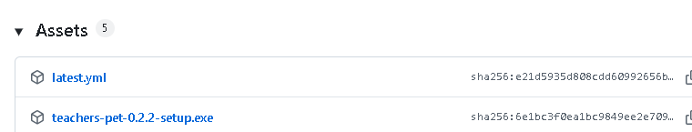
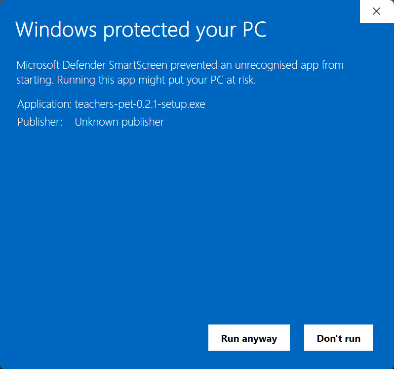
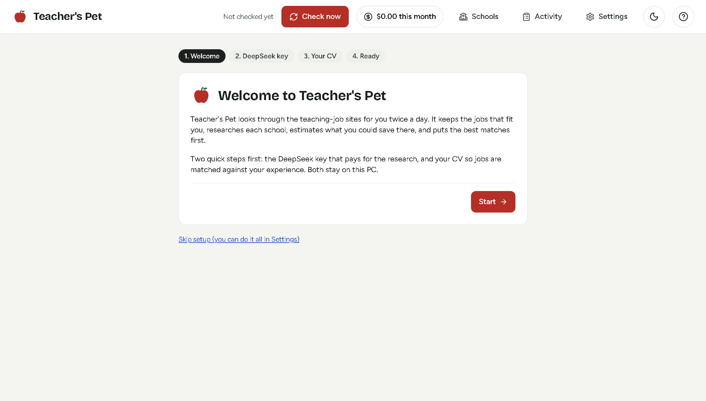
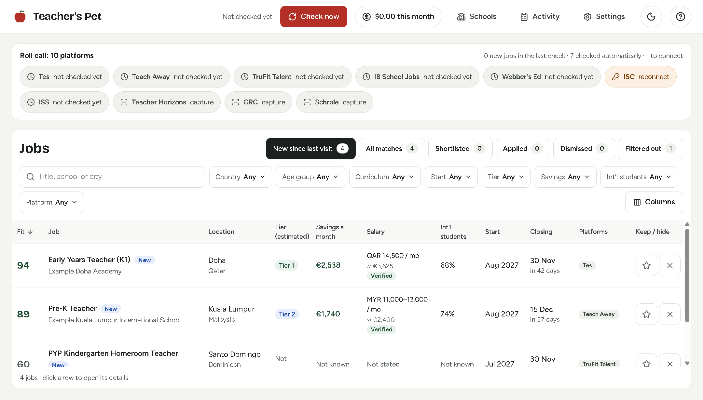
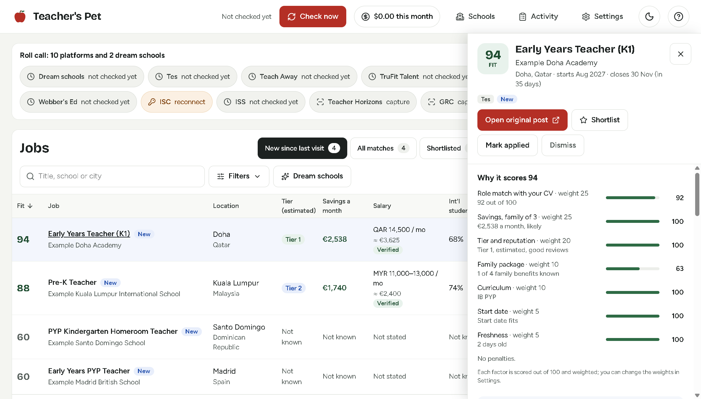
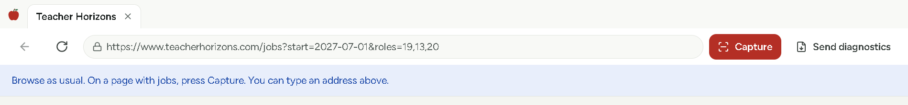
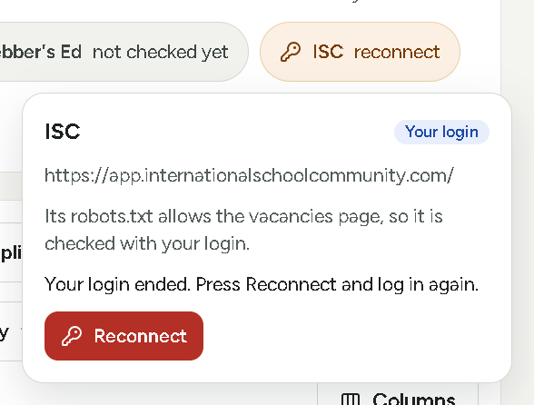

# Teacher's Pet 🍎: how to use it

Teacher's Pet checks the teaching-job sites for you twice a day. It keeps the jobs that fit you, researches each school, and puts the best matches first. The **?** button at the top of the app opens this page.

## 1. Install it

Open the [latest release](https://github.com/AbdoZwein/teachers-pet-releases/releases/latest). Under **Assets**, click **teachers-pet-…-setup.exe** to download it.

- If your browser says the file "isn't commonly downloaded", keep it. In Edge: point at the warning, click **⋯**, then **Keep**, then **Show more**, then **Keep anyway**.
- Open the downloaded file. If Windows says **Windows protected your PC**, click **More info**, then **Run anyway**. You only see this once: later updates install themselves.

Teacher's Pet installs in a few seconds, without asking anything, and opens by itself.

## 2. Open it, and do the first steps once

Teacher's Pet has an apple icon on your desktop: 

The first time it opens, it walks you through four short steps:

1. **Welcome**: press **Start**.
2. **DeepSeek key**: paste the key you were given. It pays for the school research and stays on this PC.
3. **Your CV**: choose your CV (a PDF), then check what it found and correct anything wrong. Your name and contact details are never sent anywhere.
4. **All set**: it shows the times of the two daily checks. You can change them later in **Settings**.

## 3. Check the New tab

**New since last visit** lists the jobs found since you last opened the app. The best fit is at the top.

- Press **★** to keep a job on your **Shortlisted** tab, or **✕** to hide it. Hidden jobs wait under **Dismissed**, in case you change your mind.
- Click a job to see why it scores what it does, the school's research and what you could save there. Press **Open original post** to apply on the job site.
- Type in the search box, or press **Filters** to narrow the list by country, age group, start, tier, savings and more.
- **Filtered out** lists the jobs that did not fit, each with the reason.

## 4. On Teacher Horizons, GRC and Schrole: browse, then press Capture

These three sites do not allow automatic checks, so you browse them yourself inside Teacher's Pet.

1. In the roll call at the top, click the site (it says **capture**), then **Open and capture**.
2. Log in and browse as usual. On each page with jobs, and on each job you open, press **Capture**.
3. Close the window when you are done. The captured jobs appear in your list a moment later.

Capture never reads your password or anything you type into the site.

## 5. If ISC or ISS says Reconnect, log in again

Teacher's Pet checks ISC and ISS for you with your own login. The first time, their names in the roll call say **connect**. When a login ends, they say **reconnect**.

1. Click the site, then **Connect** or **Reconnect**.
2. Log in in the window that opens. It closes by itself once you are in.
3. On ISS, the first time only, it waits for you: open your saved job search, then press **Use this page**.

## Good to know

- The checks run while your PC is on and you are signed in to Windows, even with Teacher's Pet closed. If a check was missed, it runs when you next open the app. Press **Check now** to look straight away.
- The amount at the top (for example **$0.00 this month**) is what the research has cost this month.
- If a site's jobs come out wrong, press **Send diagnostics** in that site's window. It saves a cleaned copy of the page, without your details, in **Documents › Teacher's Pet diagnostics**. Send that file to whoever set up the app for you.
- Updates download by themselves and install when you close Teacher's Pet.
